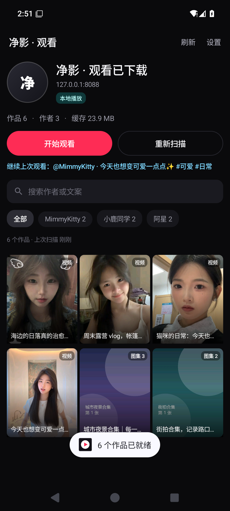
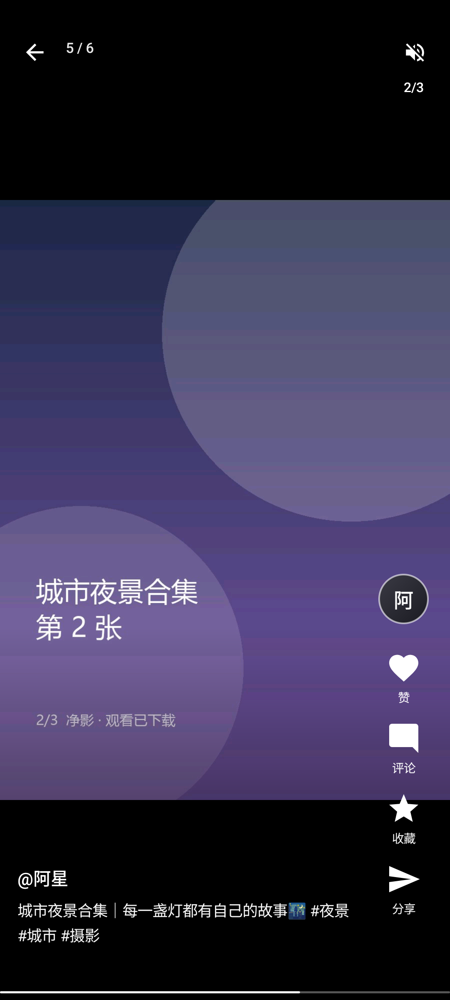
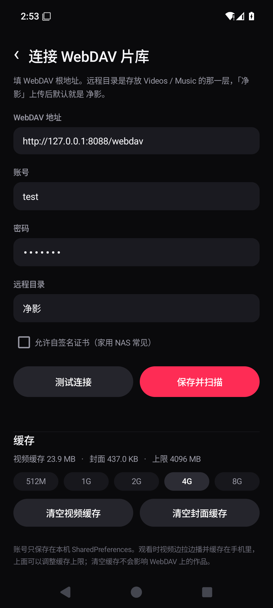

# 净影 · 观看已下载（Android）

「净影」系列的**观看分支**：不再解析抖音，也不下载，只做一件事 ——
把「净影 · 电脑版」已经上传到 WebDAV 的 `Videos/净影`、`Music/净影`
当成片库，在手机上用**抖音式竖屏信息流**看。

> 新项目、独立包名 `com.jingying.watch`，可以和「净影」下载器同时装在手机上。






---

## 功能

### 观看体验（对齐手机抖音）

- **竖屏全屏信息流**：三屏预加载，上下拖动跟手、松手吸附到上一条/下一条；
- **单击暂停 / 继续**，中间出现播放按钮；**在画面上双击则收藏当前作品**（手指位置冒心心，
  已收藏时再双击只提示、不会取消；双击在第二次按下时判定，单击只多等 280ms，不会误暂停）；
  文案下方显示作品发布时间 + 这个作品所有文件加起来的大小（如 `发布时间 2026-01-02 13:45 · 24.6 MB`）；
- **无文案作品不再显示一串抖音作品 ID**：`<作品id>.tar` 去掉扩展名只是文件名，
  电脑版还会对没文案的作品把 `文案：` 写成「抖音作品 <作品id>」当占位；这两种都不是文案。
  现在播放页整行隐藏，详情弹层也不再显示，列表 / 详情的标题回退为 `@作者 的作品`
  （作品 ID 仍留在详情里的作品链接，也仍可用于搜索）；
- **长按 2× 倍速**，底部提示「2× 播放中」，松手恢复；三级手段依次降级：
  1. **参数变速**（首选，真正的时间伸缩）。写法顺序很关键：先用
     `mp.setPlaybackParams(mp.getPlaybackParams().setSpeed(2))`——沿用播放器当前参数对象，
     它带着引擎已初始化的内部模式；`new PlaybackParams()` 是个干净对象，部分机型会
     **接受但不执行**（不抛异常、`getPlaybackParams()` 也回报 2.0，画面还是原速）。
     之前把官方推荐写法排在最后，等于永远试不到它。另有「新建带 pitch」「新建只给 speed」
     两种兜底写法；抛异常并不等于不支持（没有 Surface、缓冲中、无音轨、pitch 被拒都会抛），
     按 300ms 起逐步退避重试，缓冲结束 / 首帧 / Surface 就绪都会重新给机会；
  2. **重建播放器再试**。有些机型（华为等）第一次设倍速就是不生效，把 MediaPlayer
     释放重建、从原位置重新 prepare 之后再设才正常。这比重写播放引擎便宜得多、
     也比跳帧平滑，所以排在跳帧前面；一次长按只重建一次，重建后回到原播放位置；
  3. **跳帧兜底**（最后的保底）。播放器继续按 1× 往前走，每 300ms 往前 seek 一次、
     按 2× 时间轴追赶，叠加起来就是 2×。用 `SEEK_CLOSEST` 精确跳转——默认的
     `seekTo(int)` 是「跳到前一个关键帧」，短视频 GOP 常有 1～4 秒，每跳一次都先退回
     好几秒再往前播，画面就会反复倒退 + 黑闪（v1.0.34 的卡顿就是这么来的）；
     还会检查落点有没有落到目标前面，落到前面就重取基准，避免越追越偏。
     跳帧期间静音（音频会一顿一顿），松手立即恢复音量与原速；这是有损模式，位置跳跃前进。
  判断何时降级的依据是「设完 700ms 拿播放位置自己算推进比」，低于 1.4× 先重测一轮
  再定性（`getCurrentPosition()` 有的设备几百毫秒才刷新一次，单次采样会把「还没刷新」
  误判成「没加速」，而误判会把本来平滑的 2× 换成卡顿的跳帧）。
  提示会区分路径：参数变速显示「2× 播放中」、跳帧显示「2× 快进」、都不行才是
  「本机不支持倍速」；松手再长按会重新试一次；
- **底部细进度条**：上移到系统手势区上方，进度条下面视频显示「当前已播放 / 总时长」、
  图集显示「第 x 张 / 共 y 张」，点击/左右拖动跳转，拖动时用气泡显示目标时间；
- **右侧操作栏**：作者头像（点一下进作者主页）、收藏、分享、详情、自动下载；
  头像优先显示 WebDAV `作者资料/authors.json` 里的真实头像，找不到才回退到「首字」，
  作者名以 emoji 开头也不会显示成乱码；
- **图集作品**：顶部明确显示「图集 x/y」，图片完整显示（不裁切），3.2 秒自动轮播；
  **图片带实况动图时会动起来**：电脑版把动图存成 `动图_NN.mp4`（和 `图片_NN.jpg` 同序号），
  以前播放页只读图片、把动图整个跳过，所以实况图永远是一张静态照片；现在切到这张时会
  在同一个画面上循环播放对应的动图（静音，背景音乐不受影响），动图还没下载/读取失败时
  自动退回静态图，不会黑屏；下载作品时也会把动图一起存下来，离线同样能看；
  **自己左右滑过一张之后，这个作品就不再自动切图**（不然刚看清一张又被定时器带走），
  换到别的作品才重新开始轮播；
  **划一下必定有反应**：系统把 MOVE 事件合并掉、只剩按下/抬起时，按整段位移补判一次
  横滑（以前这种快速轻扫会被当成单击，图集被暂停、画面还停在第 1 张）；
  某一张图读取失败会退避重试 3 次，仍失败才提示「这一张图读取失败」，
  不会出现「角标已经跳到第 2 张、画面还是第 1 张」这种卡住的观感；
  点一下暂停轮播和背景音乐（中间出现 ▶），再点继续；左右滑只切图，不会被误判成上下换作品，
  有背景音乐就自动播放，右上角显示 `2/3`；
  每次切图后会**提前把前后相邻图解码进独立的图集缓存**（低优先级单线程，不抢当前图），
  所以正常划动是当帧换画面，不用等 WebDAV 下载；左右滑划过 8% 屏宽即切，
  快速轻扫在抬手时按速度补切一张；
- **自动连播**：一条播完自动滑到下一条，最后一条停在当前屏；
  手指刚滑过/正在滑的 900ms 内不会因为上一条刚好播完再跳一条；
  设置页「播放」分组里有开关，关掉后播完停在当前作品、显示播放按钮轻点重播，
  上下滑动仍然可以自己翻到下一个；
- **随机观看**：首页「随机观看」按钮把全库候选**整段打乱**后开始播放（不是只随机一个起点、然后顺着作者目录连播）；
  没读详情的作品也会参与候选，不会只随机到播放过的那几十条，连续点也不会重复同一条；
  **搜索框里的关键词不影响随机范围**：关键词只用来筛列表，随机仍然在整个片库里挑
  （作者筛选、「只看已下载」是明确的分类选择，这两个仍然生效；带关键词时会提示一句随机范围）；
- **作者列表**：首页右上角「作者」列出全部作者（头像/抖音号/作品数，可搜索），
  点作者进入作者主页；看视频时点右侧头像也直接进作者主页；
- **作者主页**：头像、抖音号、作品数 + 这个作者的全部作品网格，点作品从该作者的作品列表开始播放；
  页面上有「打开抖音主页」，用 `作者资料/authors.json` 里的 `sec_uid` 拼官方主页链接
  `https://www.douyin.com/user/<sec_uid>`，优先点名拉起抖音 App 并打开作者主页；
  **长按**这个按钮可以改用「按抖音号搜索」或「复制主页链接」；
- **本地下载**：播放页右上角「下载」把当前作品（视频/图集/背景音乐/文案）整段存到手机，
  之后断网也能看；首页长按封面也能下载/删除，顶部「已下载 N」可以直接筛出来；
- **自动下载**：右侧栏最下面的「自动下载」开关，开启后正在看的视频会自动存到本地，
  开关状态会记住；同一时间只下载一条，图集不会自动下载；
- 静音开关会记住；
- 从首页进入时从点的那条开始，退出后再进来会「继续上次观看」。

### 详情里的作品链接

- 「详情 → 复制链接」复制的不再是 `文案.txt` 里那一整行（有可能是带「复制打开抖音…」
  的分享口令，整段粘到抖音里识别不出来），而是**只抽出来的干净 URL**：
  `v.douyin.com` 短链原样保留（抖音自家分享格式，识别率最高），
  其它情况按作品 ID 拼 `https://www.douyin.com/video/<id>`（图集用 `/note/<id>`）；
- 「详情 → 抖音打开」用 `snssdk1128://aweme/detail/<作品id>` 点名拉起抖音 App
  （不经过浏览器），直接进这个作品页；抖音没装或版本太老不接时，再退回网页链接。
  网页链接在未登录的浏览器里常只显示「打开抖音观看」，看起来就像「链接打不开」，
  所以这里优先走 deep link。

### 分享作品文件

- 播放页右侧「分享」不再只发一段文字：会把这个作品的**全部文件**（视频 / 实况 /
  图集 / 文案 / 背景音乐）打包成一个 `<作品标题>-<短哈希>.tar` 再发出去；
  包里按作品名建一层目录，同名文件自动加序号。原来的文案与抖音链接仍作为文字附带。
- 打包在后台线程流式完成（单文件缓冲 256KB），带进度框和「取消」；已离线下载的文件
  直接读本地，作品包（tar）成员复用解包缓存，其余才从 WebDAV 拉。中途失败或读取长度
  对不上会报错并删掉半成品，不会发出坏包。
- 项目不依赖 androidx，没有 `FileProvider` 可用，所以自己实现了一个只读
  `ShareProvider`（`content://`、`exported=false` + 临时 URI 授权）。生成的包放在
  `cache/share/`，同一作品反复分享会覆盖，超过一天的历史包自动清理。
- 回收站预览里不分享，要先恢复；接收方需要能处理 `application/x-tar`（文件管理器、
  网盘、邮件等）。

### 收藏

- 播放页右侧第一个「收藏」按钮：点一下收藏，再点取消；已收藏时星星和文字变金色；
  在作品画面上**双击也会收藏**（只加不减，再双击不会取消）；
- 收藏列表：首页右上角「收藏」，三列封面墙，**最近收藏的在前**；
- 点任意一条就从这份收藏列表开始连着看，上下滑只在收藏里切换；
- 收藏页长按封面可以取消收藏；
- 收藏只存在本机（`SharedPreferences`，记录作品路径）：作品被删到回收站时先不显示，
  恢复后会自动回到收藏列表里。

### 删除与回收站（云端同步）

- **删除作品**：播放页「详情 → 作品详情」底部「移入回收站」；
  首页长按封面，菜单里也有「移入回收站」；
- **删除作者**：作者主页右上角「删除作者」，会把这位作者在 `Videos` 和 `Music` 下的整个目录移入回收站；
- 删除不是真的删：目录会被 `MOVE` 到 `<片库根>/回收站/<原名>__<时间>/`，里面是
  `data/`（作品或作者目录）、`music/`（对应背景音乐）和 `meta.txt`（原始路径、删除时间）；
- **回收站页面**：首页右上角「回收站」，列出所有被删条目，可以单条「恢复」，
  长按单条彻底删除，右上角「全部删除」清空回收站；
- **点条目可以直接预览**：会把回收站目录临时拼成一个作品丢进播放页（删的是作者就预览第一个作品），
  预览时下载 / 收藏 / 自动下载 / 删除都置灰，要先恢复才能用；
- 恢复会把 `data/` / `music/` 搬回原路径（父目录不存在会自动创建），并自动重新扫描片库；
- 删除和恢复前都有二次确认；**片库根目录（`Videos` / `Music`）永远不会被删**；
- 如果网盘不支持 `MOVE`（返回 405/501），App 会明确提示，并让你选择是否直接彻底删除。

### 滑动与性能

- 短促轻扫（约 40px 以上）也会翻页，不需要拖满半个屏幕；
- 事件被系统合并时用「抬手位置 + 手势时长」补速度，不会把快速轻扫误判成点击；
- 1.6 万作品的片库也能流畅滑：本地索引在后台读取，落盘在锁外序列化，
  扫描时 UI 更新做节流、增量去重，播放页不再每次翻页复制整份列表。
- 索引层针对大库做过一轮优化（细节见 `docs/TESTING.md` 第二十一轮）：
  作品 key 的 SHA-1 改为查表、目录名时间戳不再跑正则、`rel`/作者改成哈希索引、
  「已下载」判断只查内存索引（不再逐个文件 stat）、读详情的落盘合并成一次写。
- 封面加载不再同步等作品详情（`docs/TESTING.md` 第三十八轮）：以前 tar 作品取封面会
  用 25 秒的 `CountDownLatch` 占住 3 条封面线程，快速滚动时后面的格子要排几十秒；
  现在挂到详情回调上，线程只做解码/取帧。
- 首页作者 chips 分批挂载（每页 40 个），筛选时只改高亮、不重建整排；
  作者列表和「已下载 N」都按索引 revision 缓存，搜索不再反复遍历全库。
- 后面 10 个作品的预热有独立线程，拖动进度条后的续传不会排在预热任务后面；
  视频缓存大小统计缓存 15 秒，不再每次进首页都递归 stat 整个缓存目录。

### 本地下载（相册不可见）

- 下载位置：`Android/data/com.jingying.watch/files/offline/<作品 key>/`（App 私有目录），
  目录里放了 `.nomedia`，系统相册/媒体库不会扫描到；
- 播放页右上角图标：未下载是「下载」，下载中显示百分比，已下载是青色对勾；点一下已下载的可以删除；
- 右侧栏「自动下载」开启后，每看完一个作品会自动下载当前这条（视频和带背景音乐的图集都会下）；
- 首页封面左上角显示「已下载」，长按封面弹出下载/删除菜单，顶部 chip「已下载 N」只显示本地作品；
  N 只统计当前片库里仍能本地播放的作品，和点进去后的列表数量一致；
- 设置页最下面显示本地下载数量/占用/路径，可以一键清空；
- 播放时优先用本地文件，不再走 WebDAV 代理；**下载完成后杀掉 App、断网重开也能直接看**；
- 下载完成时如果当前作品还在转圈/报错，会自动切到本地文件重播，封面也会刷新，不需要退出重进；
- 注意：卸载 App / 清除应用数据会一起删掉这些私有目录里的下载。

### 参考 Tiktok 项目做的体验优化

参考 [running-libo/Tiktok](https://github.com/running-libo/Tiktok) 里适合「只看已下载」的部分：

- 文案里的 `#话题` / `@用户` 高亮，点一下只看该话题/该作者；点击不拦截上下滑手势；
- 作品详情改成底部 BottomSheet：顶部拖拽把手、上滑动画、「只看 TA」按钮；
- 加载动画改成三点呼吸效果（类似 Lottie 的轻量 Canvas 实现，不引第三方库）；
- 播放页常亮；来电/耳机拔出自动暂停，音频焦点恢复后继续；
- 图集的背景音乐等**画面（视频首帧/第一张图）出来后再响**，不会出现“音乐先响、画面还黑着”；
  画面超过 1.5 秒还没好也会放行，弱网/解包慢时不会一直没声音（详见 `docs/TESTING.md` 第三十九轮）；
- 封面和头像用 RGB_565 解码，1.6 万作品的封面墙更省内存；
- 没有搬相机、同城、登录这些和本地片库无关的模块。

### 远程目录结构

新版目录不再在 `Videos` / `Music` 下面多套一层「净影」，作者目录直接放在里面。
2026-11-08 起「净影 · 电脑版」默认**一个作品一个 tar**（旧版散目录仍然兼容）：

```
净影/
  Videos/
    <作者昵称_抖音号>/
      <作品id>.tar                 ← 新版：作品包
        └─ <作者昵称_文案_时间>/
             视频.mp4 / 图片_NN.jpg / 动图_NN.mp4 / 音乐.mp3 / 文案.txt
      <作者昵称_文案_时间>/         ← 旧版：散文件目录
        视频.mp4 / 图片_NN.webp / 文案.txt
  Music/
    <作者昵称_抖音号>/<同名作品目录>/音乐.mp3   ← 仅旧版
  作者资料/
```

作品包只会在**第一次打开**时读 tar 头列成员（Range 读 512 字节头，不下载视频本体），
播放/看图时再把需要的那一个成员解到本地缓存；封面、详情、离线下载、回收站都兼容
`<作品id>.tar`。旧版 `Videos/净影/<作者>/...` 也仍然兼容，App 扫描时会自动识别；
如果移动目录后首页还是旧作品，点一次「重新扫描」即可。

### 片库与缓存

- **WebDAV 读写**：PROPFIND 两层扫描（作者目录 → 作品目录），既认
  `Videos/净影/<昵称_抖音号>/<昵称_文案_时间>/` 旧目录，也认作者目录下的
  `<作品id>.tar`；删除走 `MOVE`（移入回收站）/ `DELETE`（清空回收站），
  并会用到 `MKCOL`、`PUT` 写 `meta.txt`；
- **作品包（tar）**：扫描时把 `<作品id>.tar` 当成一个作品；详情只按 Range 读
  tar 头列成员（不下载视频本体），播放/看图时再把需要的成员解到
  `files/archive/<包哈希>/`，整包解包缓存上限 2GB、按最后访问清理；
  旧版散目录作品完全不受影响；
- **边拉边播**：本机 `127.0.0.1` 起一个带鉴权的 Range 代理，
  播放器看不到 WebDAV 账号，也不会把地址暴露给播放器；
- **本地缓存**：看过的片段留在手机上，整段下完后下次直接本地读；
  容量上限 512M–8G 可选，超出后按 LRU 清理；
- **预取**：当前和下一个视频提前拉，滑过去就能直接播；
- **后面 10 个作品预热**：进入播放页后提前读后面 10 个作品的详情；普通视频再预取
  开头 2MB（只预热、不整段下载），切过去时接着续传；`<作品id>.tar` 作品只预载
  包信息，视频仍等切到该条时再解包；
- **离线可用**：片库索引和封面缓存在本机，断网启动也能先看到上次的片库；
- **首页**：抖音个人页风格，封面墙（视频首帧 / 图集首图）、搜索、作者筛选、
  继续上次观看、缓存统计。
- **搜索框**：搜作者名 / 文案 / 标题，停手 260ms 才筛（只差首尾空格不算改动，
  不会白重建 1.6 万条）；**拼音还没上屏时不筛**，等输入法提交候选词再筛，
  所以删字、改拼音时列表不会忽有忽无；**删空立刻恢复全量**并把列表回到顶部，
  右侧有一键清空；重建列表时会保住光标，不会出现「光标跳到开头、按退格删不掉」；

### 设置

- WebDAV 地址 / 账号 / 密码 / 远程目录；
- 「允许自签名证书」开关（家用 NAS 常见）；
- 测试连接、保存并扫描；
- 「播放」分组：「播放结束后自动连播下一个」开关，改完立即生效，不需要点保存；
- 缓存上限、清空视频缓存、清空封面缓存。

---

## 远程目录约定

与「净影 · 电脑版」上传的结构完全一致。新版是「一个作品一个 tar」：

```text
<远程目录>/Videos/<昵称>_<抖音号>/<作品id>.tar
    包内：<昵称>_<文案>_<yyyyMMdd_HHmmss>/
        视频.mp4 / 图片_01.jpg / 动图_01.mp4 / 音乐.mp3 / 文案.txt
<远程目录>/Videos/<昵称>_<抖音号>/<昵称>_<文案>_<时间>/   （旧版散目录，仍兼容）
    视频.mp4 / 图片_01.webp / 文案.txt
<远程目录>/Music/<昵称>_<抖音号>/<同名作品目录>/音乐.mp3  （旧版的独立音乐）
```

`文案.txt` 里会读 `作者 / 抖音号 / 发布时间 / 作品链接 / 文案`，
用来补全作者名、发布时间、分享链接和完整文案。

默认远程目录是 `净影`；如果 WebDAV 根地址下直接就是 `Videos`、`Music`
（没有 `净影` 这一层），把远程目录填成 `/` 或留空也能自动识别
（扫描时会向下找最多 3 层）。

---

## 快速开始

### 1. 构建 APK

项目不依赖 Gradle，直接用 Android SDK 的 `aapt2 / javac / d8 / apksigner`：

```powershell
cd jingying-watch\android
powershell -ExecutionPolicy Bypass -File .\build.ps1
# 想先跑一遍单元测试： powershell -ExecutionPolicy Bypass -File .\build.ps1 -Test
```

产物：`android\JingYing-Watch-v<版本>.apk`，同时会生成固定名的
`android\JingYing-Watch-latest.apk` 和项目根目录的同名副本（始终指向最新一次构建，安装脚本用它）。

**版本号自动递增**：`android\version.properties` 记录 `versionCode` / `versionName`，
每次构建自动 +1（`1.0.0 → 1.0.1 → …`），`aapt2` 会把它们写进 APK，
设置页底部也会显示「v1.0.3（build 13）」这样的版本信息，方便确认手机装的是哪一次构建。
调试时不想让版本号增长，用 `powershell -ExecutionPolicy Bypass -File .\build.ps1 -NoBump`；
想改主/次版本（比如升到 1.1.0）直接编辑 `version.properties` 即可。

构建环境（脚本按「项目自带 → 环境变量 → 上层工作区共享 tools」的顺序查找，
所以整个 `jingying-watch` 目录拷到别的机器也能直接构建）：

- JDK 17（放在 `tools\jdk17`，或设 `JAVA_HOME`）
- Android SDK Platform 35 + Build-Tools 35.0.0
  （放在 `tools\android-sdk`，或设 `ANDROID_HOME`）

测试用的 `org.json` 放在 `tools\json.jar`（随项目一起走）。

### 2. 安装

```powershell
adb install -r android\JingYing-Watch-latest.apk
```

或把 APK 传到手机点击安装（首次需允许「安装未知来源应用」）。

### 3. 在模拟器 / MuMu 上运行

**Android Studio 模拟器**：

```powershell
adb install -r android\JingYing-Watch-latest.apk
adb reverse tcp:8088 tcp:8088   # 只有用本机 mock WebDAV 测试时才需要
```

**MuMu 模拟器**（端口以 MuMu 实际设置为准，通常是 7555）：

```powershell
adb connect 127.0.0.1:7555
adb install -r android\JingYing-Watch-latest.apk
```

MuMu 里访问电脑上的 WebDAV 服务，地址用电脑局域网 IP
（或先用 `adb reverse` 把端口映射进模拟器，再用 `127.0.0.1`）。

### 4. 连接 WebDAV

打开 App →「去连接」→ 填：

- 地址：`https://webdav.123pan.cn/webdav`（示例）
- 账号 / 密码：网盘的 WebDAV 账号
- 远程目录：`净影`
- 家用 NAS 自签证书：勾选「允许自签名证书」

点「保存并扫描」，看到 `6 个作品` 之类的提示后回首页即可。

---

## 本地演示片库（不用真实网盘也能跑）

`tools/` 里带了一个只依赖 Python 标准库的 WebDAV 测试服务和演示片库生成器：

```powershell
# 1) 生成演示片库（会从 Downloads/ali 里挑几段真实短视频，补上图集/音乐/文案）
python tools\make_fixtures.py

# 2) 启动 mock WebDAV（默认 http://127.0.0.1:8088/webdav，账号 test / test123）
python tools\mock_dav.py --port 8088
```

App 里连接：

- 标准 Android 模拟器：`http://10.0.2.2:8088/webdav`
- 真机 / MuMu + `adb reverse tcp:8088 tcp:8088`：`http://127.0.0.1:8088/webdav`
- 同一局域网真机：`http://<电脑IP>:8088/webdav`

演示片库的目录结构、文案、图集、背景音乐和真实片库一致，
用来验证扫描、封面、边拉边播、进度拖动、图集轮播等整条链路。

---

## 测试

本机实测记录见 [`docs/TESTING.md`](docs/TESTING.md)，包含：

- 用 Android 15（API 35）模拟器完整跑通的截图；
- 扫描 / 播放 / 滑动 / 双击收藏 / 长按 2× / 进度拖动 / 图集 / 设置 / 缓存复用；
- 复现步骤与已知限制。

### 单元测试（纯 Java，不需要手机/模拟器）

```powershell
cd jingying-watch
powershell -ExecutionPolicy Bypass -File .\tools\run-tests.ps1
```

只编译不依赖 Android 的那几个类（`Work` / `RemoteFile` / `Mime` / `Library` / `Util` /
`Shuffles` / `DouyinLinks` / `TarReader` / `TarWriter` / `HttpLite` / `AlbumNav` /
`LocalFiles` / `TapNav` / `PlayNav`），用桌面 JVM 直接跑，覆盖目录名解析、
文件分类、详情落盘往返、重扫时的骨架合并、筛选排序、统计、随机打乱、抖音链接、
体积/时长格式化、tar 作品包读写、分享打包往返（生成的包还用系统 tar 与 Python tarfile
交叉验证过）、作品链接抽取与归一化（分享口令 → 干净 URL、短链保留、
`snssdk1128://aweme/detail/<id>` deep link），以及 WebDAV 重定向时的凭据保护、
空文案时不回退到作品 ID、
图集循环索引 / 相邻预取目标 / 左右滑切图阈值与快扫兜底 / 抬手补判横滑方向 /
手动切过后停轮播 /
图片与动图的序号配对（`动图_01.mp4` ↔ `图片_01.jpg`，缺动图/旧包无序号/数量不符）、
离线目录的完成判定与文件清单折叠、双击判定窗口与单击延迟的不变式、播完后的去向
（连播开关 × 有无下一条 × 刚滑过的 900ms 宽限）、长按倍速的写法降级与退避重试、
「设完参数拿播放位置实测有没有真加速」与跳帧兜底的目标时间轴（含尾部留白、时长未知不跳）、
搜索框的防抖 / 拼音组合期等待 / 关键词去重。
脚本会把工作目录固定到项目根，从任意位置调用都不会把临时文件建到别处。

构建时加 `-Test` 会先跑一遍测试，失败就中止打包：

```powershell
powershell -ExecutionPolicy Bypass -File .\android\build.ps1 -Test
```

> 依赖 JDK 17（项目自带 `tools\jdk17`，或 `JAVA_HOME`）和 `tools\json.jar`（`Work` 用到 org.json）。

---

## 项目结构

```text
jingying-watch/
├─ android/
│  ├─ build.ps1                    # aapt2 + javac + d8 + zipalign + apksigner
│  ├─ JingYing-Watch-latest.apk    # 构建产物
│  └─ app/src/main/
│     ├─ AndroidManifest.xml
│     ├─ java/com/jingying/watch/
│     │  ├─ App.java               # 全局单例：设置/索引/代理/扫描器
│     │  ├─ HomeActivity.java      # 片库首页（抖音个人页风格）
│     │  ├─ FeedActivity.java      # 竖屏播放页
│     │  ├─ FeedPager.java         # 三屏翻页 + 手势（滑/点/双击/长按/进度）
│     │  ├─ FeedPage.java          # 一屏作品（视频或图集 + 覆盖层）
│     │  ├─ AlbumNav.java          # 图集循环索引 / 相邻预取 / 切图阈值 / 轮播条件（纯 Java，可单测）
│     │  ├─ TapNav.java             # 双击窗口 / 单击延迟判定（纯 Java，可单测）
│     │  ├─ PlayNav.java            # 播完去向：连播 / 重播 / 刚滑过不动（纯 Java，可单测）
│     │  ├─ LocalFiles.java        # 离线目录完成判定 / 文件清单（纯 Java，可单测）
│     │  ├─ SpeedNav.java           # 长按倍速：写法降级 / 实测是否真加速 / 跳帧兜底（纯 Java，可单测）
│     │  ├─ SearchNav.java          # 搜索框防抖 / 拼音组合期等待 / 关键词去重（纯 Java，可单测）
│     │  ├─ MediaProxy.java        # 本地 Range 代理 + 磁盘缓存 + 预取
│     │  ├─ LibraryScanner.java    # WebDAV 两层扫描 / 详情 / 文案 / 音乐
│     │  ├─ TarReader.java         # tar 头解析 / 成员解包（PAX、长文件名）
│     │  ├─ TarWriter.java         # 流式写 USTAR 包（分享作品时用）
│     │  ├─ WorkShare.java         # 汇总作品文件 / 后台打包 / 进度与取消
│     │  ├─ ShareProvider.java     # 只读 content:// 授权（替代 FileProvider）
│     │  ├─ DavTarSource.java      # 按 Range 从 WebDAV 的 tar 里读成员
│     │  ├─ ArchiveStore.java      # 作品包解包缓存 / 离线包复用 / LRU
│     │  ├─ LibraryStore.java      # 本地片库索引（JSON）
│     │  ├─ TrashStore.java        # 云端回收站：移入 / 列出 / 恢复 / 清空
│     │  ├─ TrashActivity.java     # 回收站页面
│     │  ├─ FavoriteStore.java     # 收藏（本机保存作品路径）
│     │  ├─ FavoriteActivity.java  # 收藏夹页面
│     │  ├─ DavClient.java         # WebDAV（PROPFIND/HEAD/Range/MOVE/DELETE/MKCOL/PUT）
│     │  ├─ HttpLite.java          # Socket HTTP/1.1（支持 PROPFIND 等自定义方法）
│     │  ├─ ImageLoader.java       # 封面：视频首帧 / 图集首图
│     │  ├─ Work.java              # 作品模型与目录名解析
│     │  └─ …
│     └─ res/                      # 图标、颜色、主题
├─ tools/
│  ├─ mock_dav.py                  # 标准库 WebDAV 测试服务
│  ├─ make_fixtures.py             # 演示片库生成器
│  ├─ run-tests.ps1                # 纯 Java 单元测试（桌面 JVM）
│  ├─ test/                        # 单元测试源码（WatchTests）
│  └─ fixtures/webdav/             # 生成的演示片库
└─ docs/
   ├─ TESTING.md                   # 实测记录
   └─ screenshots/
```

### 播放链路

```text
MediaPlayer ──http://127.0.0.1:PORT/m/<key>/<文件名>──▶ MediaProxy
                                                         │
                                     Range 请求 + Basic 鉴权│
                                                         ▼
                                                   WebDAV（123pan / NAS）
                                                         │
                                                         ▼
                                            files/media/<key>.mp4
                                             （边下边写、整段完成后复用）
```

- `MediaProxy` 维护每个文件的「已下载区间」，播放器拖到哪就补到哪；
- 已缓存区间直接本地读，不重复走网络；
- 整段下完写一个 `.ok` 标记，下次启动直接命中缓存；
- 未完成的半截文件在启动时清掉，避免读到空洞数据。

---

## 已知限制

- 目前是 **Android 端**；电脑端仍可继续用「净影云播」看同一份 WebDAV 片库。
  两边的目录约定、缓存策略是同一套，后续把 `library + proxy + 播放器覆盖层`
  复用到桌面端即可。
- 评论数、点赞总数等社交数据 WebDAV 上没有，所以只做本机点赞/收藏，
  右侧「详情」按钮打开的是「作品详情」（文案、作者、路径、复制链接、抖音打开）；作品已离线下载时
  还会一起列出**本地文件目录**：目录绝对路径（点按即可复制，长按可选中）和目录里的
  作品文件清单（文件名 + 大小，超过 6 个折叠）。下载中或未下载的作品不显示这一段。
- 暂不支持 HLS（m3u8）和加密视频；抖音下载下来的 mp4 / 图集都支持。
- 图集实况动图只认电脑版导出的 `动图_NN.mp4`（与 `图片_NN.jpg` 同序号配对的视频）。
  如果某个包里的「动图」其实是一张 animated WebP / GIF（没有对应的 mp4），
  当前仍只显示第一帧；这类需要另做逐帧解码。
- 视频解码依赖手机硬解；极少数 HEVC 10bit 机型可能放不了。
- **作品包封面**：屏幕上看得到的 tar 作品会自动读详情并生成封面：≤80MB 的视频先把
  `视频.mp4` 整段解到本地再取首帧（解包缓存和播放共用，点开时不用再解一次），
  更大的视频先用 `MediaDataSource` 按 Range 取帧、失败再退回解包；图集按需解出首图。
  失败留下的占位图会在 20 秒后自动重试，不会再永久挡住真封面。
- **作品包播放仍整段解包**：封面/取帧阶段不整段解大视频（除非 Range 取帧失败），
  但点开播放时仍会先把 `视频.mp4` 解到本地（否则没法交给播放器）；
  可见作品的视频会占用解包缓存，默认上限 2GB，可在设置页清理。
- **作品包详情走 Range**：读 tar 头/成员是一串小 Range 请求；少数不支持 Range 的
  服务器会退回「整包下到 `files/archive/full` 再解」，第一次打开会更慢。
- **新版 tar 与旧版 App**：旧版只认散目录，看不到新上传的 `<作品id>.tar`；本版
  两种结构都认。解包缓存默认上限 2GB，可在设置页查看/清空。
- 123pan 的下载 CDN 偶尔会断 TLS；媒体下载已改用系统 TLS 栈，失败会自动重试/退避，
  仍失败时轻点画面可重试。
- 首次启动读 8MB 左右的片库索引时，首页会先显示「正在读取本地片库…」，随后自动出现。
- **删除先走回收站**：作品/作者会移到 `<片库根>/回收站/`，只有在回收站里「全部删除」
  或长按单条才会真正删掉；WebDAV 账号需要写权限（`MOVE` / `DELETE` / `MKCOL` / `PUT`），
  只读账号会提示 401/403，不会假装删掉。
- **拉起抖音**用官方主页链接 `https://www.douyin.com/user/<sec_uid>`，
  并且**先显式指定抖音包名**（`com.ss.android.ugc.aweme` / 极速版）再启动，
  这样浏览器不会抢先接走 https 链接；抖音没装或不认这条路由时才逐级退回
  系统派发（浏览器/选择器）→ 数字 UID 的 scheme → 按抖音号搜索 → 网页版。
  注意 `snssdk1128://user/profile/` 后面要的是**数字 UID**，塞 `sec_uid` 会「抖音打开了但主页空白」。
  演示片库里的 `sec_uid` 是假值（`MS4wLjABAAAA-demo-*`），点开一定空白，要用真实片库。
- 回收站是**云端目录**，换手机/重装 App 后仍然能恢复；恢复时如果原位置已经有同名目录，
  会拒绝覆盖并提示先处理那一份。

---

## 隐私 / 版权

- 账号只保存在本机 `SharedPreferences`，不上传任何服务器；
- 观看和删除都只在本机与你的 WebDAV 之间流动，不经过任何第三方服务；
- 仅用于观看你拥有权利或已获授权的内容，请勿二次分发。
